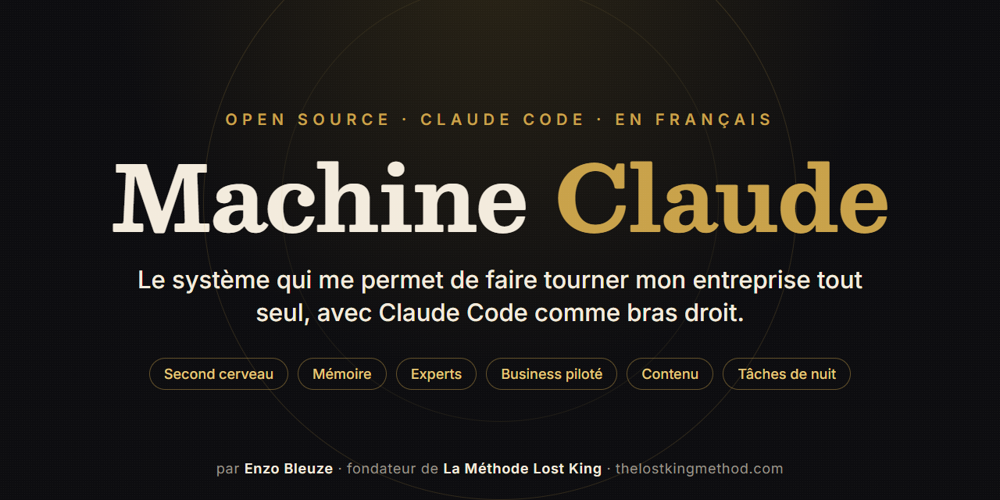
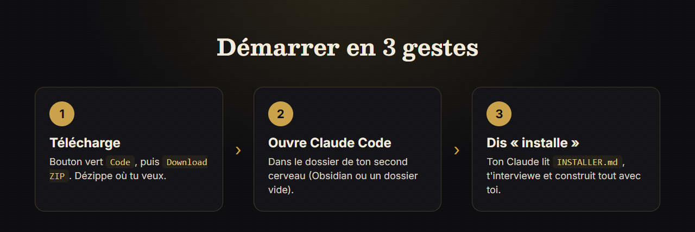
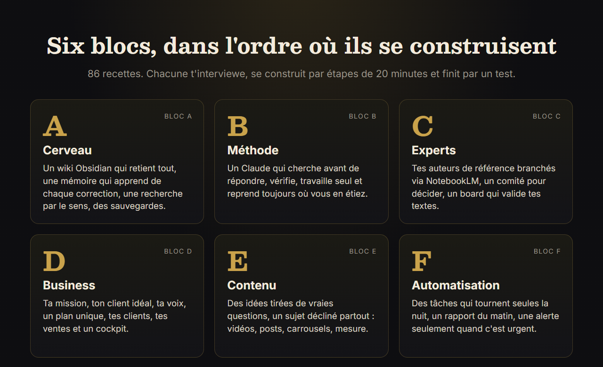
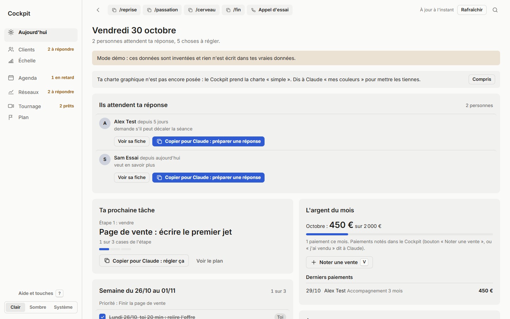

<p align="center">
  
</p>

<h1 align="center">Machine Claude</h1>

<p align="center">
  <strong>Le système open source qui transforme Claude Code en bras droit d'entrepreneur.</strong><br>
  Second cerveau, mémoire, experts, business piloté, machine à contenu et tâches de nuit. En français.
</p>

<p align="center">
  <a href="https://github.com/enzobleuze/machine-claude/stargazers"></a>
  <a href="LICENSE"></a>
  <a href="CHANGELOG.md"></a>
  
  
  <a href="https://github.com/enzobleuze/machine-claude/commits/main"></a>
</p>

<p align="center">
  <a href="#-démarrer-en-3-gestes">Démarrer</a> ·
  <a href="#-pourquoi-jai-construit-ça">Pourquoi</a> ·
  <a href="#-les-six-blocs">Les six blocs</a> ·
  <a href="#-questions-fréquentes">Questions</a> ·
  <a href="#-demande-une-mise-à-jour">Demander une mise à jour</a> ·
  <a href="https://thelostkingmethod.com">Mon site</a>
</p>

---

**Machine Claude** est une recette complète, gratuite et open source, pour que ton Claude Code devienne le bras droit d'un entrepreneur seul : il retient tout, vérifie ses réponses auprès de tes experts, pilote ton business avec un plan unique, produit ton contenu et travaille la nuit pendant que tu dors. Je l'ai construite pour faire tourner **La Méthode Lost King** tout seul, puis je l'ai partagée pour que ma famille puisse lancer son propre business.

Tu n'as pas besoin de savoir coder. Télécharge le dossier, ouvre-le avec Claude Code et dis « installe ». Ton Claude t'interviewe et construit tout avec toi, une étape de 20 minutes à la fois.

> ⭐ **Si ce projet t'aide, mets-lui une étoile.** Ça prend une seconde et c'est ce qui permet à d'autres entrepreneurs de le trouver.

---

## 💡 Pourquoi j'ai construit ça

Je m'appelle **Enzo Bleuze**. Je suis coach et fondateur de [La Méthode Lost King](https://thelostkingmethod.com), un accompagnement pour les hommes francophones qui traversent une crise de couple. Ma mission tient en une phrase : aider en français les hommes qui n'osent pas demander de l'aide, en donnant avant de recevoir.

Depuis 2022, j'ai aidé des centaines d'hommes. Mon premier modèle reposait sur la publicité payante et sur moi, à la main, du matin au soir. Il marchait, et il m'a épuisé. J'ai fait une pause pour construire autre chose : un système où l'IA porte la charge répétitive, pour que mon temps aille là où il compte vraiment, écrire, coacher et vendre.

Ce système, c'est la Machine Claude. Elle est née de mes erreurs autant que de mes réussites, et chacune y est notée pour que tu ne la refasses pas.

### Ce qu'elle fait pour moi, chaque jour

- **Elle se souvient de tout.** Mes notes, mes appels, mes clients, mes sources et chaque correction que je lui donne vivent dans un second cerveau Obsidian qu'elle consulte avant de répondre.
- **Quand j'ouvre une session**, je dis « on reprend » et elle sait où on en est, ce qu'elle a fait seule et la prochaine action.
- **Mes textes passent devant un board d'experts** branchés par NotebookLM avant d'être publiés, affirmation par affirmation.
- **Un cockpit** me montre chaque matin qui attend ma réponse, l'argent du mois et ma prochaine tâche.
- **Une vidéo longue** devient des Shorts, des posts et des carrousels, mesurés ensuite pour apprendre ce qui marche.
- **La nuit**, des tâches tournent seules, et le matin un rapport court m'attend. Mon téléphone ne sonne que pour l'urgent.

Résultat : je mène ma mission seul, sans m'épuiser, et le système s'améliore un peu chaque semaine.

### Et pourquoi je le donne

Au départ, c'était pour moi. Puis ma mère a voulu lancer son business, ma sœur aussi, puis des amis. Plutôt que de tout réexpliquer, j'ai transformé mon système en recette générique, que n'importe quel Claude Code peut installer et adapter à **n'importe quel business** : coach, artisan, consultant, boulangère, créateur de contenu.

Je crois qu'un entrepreneur seul et bien outillé peut aller très loin. Si cette recette t'en fait gagner un bout, elle a rempli son rôle.

---

## 🚀 Démarrer en 3 gestes

<p align="center"></p>

1. **Télécharge** ce dossier : bouton vert « Code », puis « Download ZIP ». Dézippe-le où tu veux, par exemple dans tes Documents.
2. **Ouvre Claude Code** dans le dossier où tu veux ton second cerveau : ton dossier Obsidian si tu en as un, sinon un dossier vide que Claude préparera.
3. **Écris à Claude :**

   ```text
   Lis le fichier INSTALLER.md du dossier machine-claude (donne le chemin) et installe-le.
   ```

Ensuite, chaque fois que tu veux avancer, une seule phrase suffit : **« On continue le parcours. »**

Pour créer du contenu qui touche exactement ton client idéal, suis [GUIDE-CONTENU.md](GUIDE-CONTENU.md) : le chemin pas à pas, du premier entretien jusqu'au contenu publié et mesuré.

### Ce dont tu as besoin

| Indispensable | Optionnel, guidé par Claude au bon moment |
|:-|:-|
| Un abonnement Claude (Pro ou Max) | [Obsidian](https://obsidian.md) (gratuit) |
| [Claude Code](https://claude.ai/download) installé | Un compte GitHub (gratuit) |
| Un ordinateur Windows, Mac ou Linux | [NotebookLM](https://notebooklm.google.com) (gratuit) |
| | Node et Python (gratuits) |

---

## 🧱 Les six blocs

<p align="center"></p>

| Bloc | Ce que tu obtiens |
|:-|:-|
| **A. Cerveau** | Un wiki qui retient tout, une mémoire qui apprend de chaque correction, une recherche par le sens, des sauvegardes |
| **B. Méthode** | Un Claude qui cherche avant de répondre, parle peu, vérifie, travaille seul et reprend toujours là où tu en étais |
| **C. Experts** | Tes auteurs et formations de référence branchés à Claude, un comité pour les décisions, un board qui valide tes textes |
| **D. Business** | Ta mission, ton client idéal, ta voix, un plan unique, tes clients, tes ventes, un tableau de bord |
| **E. Contenu** | Des idées tirées de vraies questions, un sujet décliné partout, vidéos, posts, carrousels, mesure |
| **F. Automatisation** | Des tâches qui tournent seules la nuit, avec un rapport le matin et des alertes seulement quand c'est urgent |

**86 recettes** (des skills Claude Code), toutes construites sur le même modèle : une interview pour l'adapter à toi, des étapes de 20 minutes au plus, un test qui prouve que c'est fait, et les pièges que j'ai vécus. Le business passe avant l'outillage : dès le bloc D, au moins la moitié de ton temps va à servir et vendre.

La carte complète est dans [parcours/blueprint.md](parcours/blueprint.md).

---

## 🖥️ Le cockpit, en vrai

Une des briques du bloc D : une petite application locale qui rassemble ta journée sur un seul écran. Voici son mode démo, avec des données inventées.

<p align="center"></p>

Il prend tes couleurs grâce à la brique `charte-graphique`, en clair comme en sombre.

---

## 🧭 Les leçons apprises à la dure

Ce sont les erreurs qui m'ont coûté le plus cher. La machine est construite pour t'empêcher de les refaire.

1. **Outiller avant de vendre.** Des mois de construction sans revenu. Le système est là pour servir ton business, et c'est ton business qui fixe ses priorités.
2. **Plusieurs plans qui se contredisent.** Il faut un seul plan vivant, avec une ligne « PROCHAINE ».
3. **Des plans géants** font geler. Mieux vaut des planchers de 20 minutes.
4. **Produire en masse.** Des dizaines d'articles générés automatiquement n'ont presque rien rapporté. Mieux vaut peu de contenu, vrai, écrit pour une vraie personne.
5. **Lancer des pubs avant un parcours client complet** a brûlé de l'argent. L'organique et le tunnel d'abord.
6. **Une règle notée seulement dans un wiki finit oubliée.** Pour qu'elle tienne, je la loge dans le CLAUDE.md, dans un script ou dans un hook qui la fait respecter.

<details>
<summary>Voir les six autres leçons</summary>

7. **Un outil qui « embellit » les textes peut inventer** (il a ajouté de fausses études chiffrées). Chaque chiffre se vérifie par la source.
8. **Une question globale à un expert laisse passer des erreurs.** Le board juge affirmation par affirmation.
9. **Les agents IA installés d'office dans un outil** (CRM, réseaux) ont créé de faux brouillons. Tout agent se vérifie avant d'être allumé.
10. **Trop de notifications** et on n'en lit plus aucune. Seul l'urgent sonne, le reste va au résumé.
11. **Des dizaines de passations sans état unique** font tourner en rond. Il faut un seul plan et un seul journal.
12. **Après chaque ajout** (une source, un outil, une règle), se demander : faut-il un skill, un souvenir, un hook, supprimer l'ancien ou changer un prompt ?

</details>

---

## 📁 Ce que contient le dépôt

```text
machine-claude/
├── README.md            ce que tu lis
├── INSTALLER.md         le point d'entrée pour ton Claude
├── CLAUDE.modele.md     le cœur à fusionner dans ton CLAUDE.md
├── GUIDE-CONTENU.md     le chemin du contenu, pour toi
├── CHANGELOG.md         ce qui change à chaque version
├── parcours/            la carte des six blocs et ton tableau de suivi
├── outils/              des scripts génériques testés (Python, shell, PowerShell)
└── .claude/
    ├── skills/          86 recettes, une par brique
    ├── commands/        /reprise, /passation, /fin, /cerveau, /idee, /vente...
    ├── hooks/           anti-suppression, bibliothécaire au démarrage, liens du wiki
    └── agents/          des sous-agents modèles (dont le client idéal)
```

---

## ❓ Questions fréquentes

<details>
<summary><strong>C'est vraiment gratuit ?</strong></summary>

Oui, sous licence MIT. Il te faut seulement un abonnement Claude (Pro ou Max) pour faire tourner Claude Code. Les autres outils proposés ont tous une version gratuite.
</details>

<details>
<summary><strong>Il faut savoir coder ?</strong></summary>

Non. Ton Claude écrit les fichiers, les scripts et les tests. Toi, tu réponds à ses questions et tu fais ce qui demande tes mains : te connecter à un compte, valider un choix. Chaque interface est expliquée clic par clic.
</details>

<details>
<summary><strong>Ça marche pour mon business, même s'il n'a rien à voir avec le coaching ?</strong></summary>

Oui. La recette transmet la mécanique et laisse mon contenu chez moi. Chaque brique commence par une interview sur toi, ton client, ta voix et tes sources. Ma mère l'installe en ce moment pour son propre projet.
</details>

<details>
<summary><strong>Où vont mes données ?</strong></summary>

Chez toi. Ton second cerveau est un dossier de fichiers sur ton ordinateur. Rien n'est envoyé ailleurs sans que tu branches toi-même un service. La brique `securite-git-secrets` protège tes clés et tes mots de passe avant toute sauvegarde.
</details>

<details>
<summary><strong>Windows, Mac ou Linux ?</strong></summary>

Les trois. Quand une étape diffère (tâches planifiées, chemins), la recette donne les deux variantes. Le système d'origine tourne sous Windows.
</details>

<details>
<summary><strong>Comment je mets à jour ma machine ?</strong></summary>

Télécharge la nouvelle version, puis écris à Claude : « Mets à jour la machine depuis ce dossier ». Il lit le [CHANGELOG](CHANGELOG.md), applique seulement ce qui est nouveau et garde tout ce que tu as personnalisé. Clique sur **Watch** en haut de cette page, puis « Custom » et « Releases », pour être prévenu.
</details>

---

## 🛠️ Un chantier en cours

Je suis honnête avec toi : ce n'est pas parfait. C'est le système que j'utilise tous les jours pour mon entreprise, et il évolue avec elle. Chaque semaine, ce que j'apprends de nouveau est généralisé puis ajouté ici.

Ce qui arrive ensuite :

- [ ] Une vidéo de démonstration de l'installation, du début à la fin
- [ ] Plus d'exemples remplis pour d'autres métiers que le coaching
- [ ] Une version anglaise des recettes
- [ ] Ce que tu me demanderas 👇

## 🙋 Demande une mise à jour

Ça me ferait vraiment plaisir d'améliorer le système pour toi. Si une brique te manque, si une étape te bloque ou si tu as une idée, dis-le-moi.

- **[Propose une idée ou demande une mise à jour](https://github.com/enzobleuze/machine-claude/issues/new?template=demande.yml)**
- **[Signale un problème](https://github.com/enzobleuze/machine-claude/issues/new?template=probleme.yml)**

Les contributions sont bienvenues aussi : lis [CONTRIBUTING.md](CONTRIBUTING.md), c'est court.

## 📣 Fais-le connaître

Tu connais un entrepreneur seul qui se noie dans les tâches ? Envoie-lui ce lien.

<p>
  <a href="https://twitter.com/intent/tweet?text=Machine%20Claude%20%3A%20le%20syst%C3%A8me%20open%20source%20d%27Enzo%20Bleuze%20pour%20faire%20tourner%20son%20entreprise%20seul%20avec%20Claude%20Code&url=https%3A%2F%2Fgithub.com%2Fenzobleuze%2Fmachine-claude"></a>
  <a href="https://www.linkedin.com/sharing/share-offsite/?url=https%3A%2F%2Fgithub.com%2Fenzobleuze%2Fmachine-claude"></a>
  <a href="https://www.facebook.com/sharer/sharer.php?u=https%3A%2F%2Fgithub.com%2Fenzobleuze%2Fmachine-claude"></a>
</p>

Et si ce n'est pas déjà fait : ⭐ **une étoile en haut de la page**, ça compte vraiment.

<p align="center">
  <a href="https://star-history.com/#enzobleuze/machine-claude&Date">
    
  </a>
</p>

---

## 👑 L'auteur

**Enzo Bleuze**, coach et fondateur de **La Méthode Lost King**, basé à Montréal. J'aide les hommes francophones à traverser une crise de couple et à redevenir le leader de leur vie. Cette machine est l'outil qui me permet de le faire seul.

- 🌐 Site : [thelostkingmethod.com](https://thelostkingmethod.com)
- ▶️ YouTube : [@enzobleuze](https://www.youtube.com/@enzobleuze)
- 📸 Instagram : [@enzo.bleuze](https://www.instagram.com/enzo.bleuze/)

Merci d'être passé. Construis quelque chose qui compte.

---

<details>
<summary>🇬🇧 <strong>In English</strong></summary>

**Machine Claude** is a free, open-source recipe (MIT) that turns [Claude Code](https://claude.ai/download) into a solo entrepreneur's right hand: an Obsidian second brain with memory, expert notebooks via NotebookLM, a single business plan with a local cockpit app, a content machine (videos, Shorts, posts, carousels) and night-time automations. It contains 86 step-by-step skills in six blocks, each starting with an interview so it adapts to any business.

It was built by **Enzo Bleuze**, founder of **La Méthode Lost King** ([thelostkingmethod.com](https://thelostkingmethod.com)), to run his coaching business alone, then shared so his family could start their own. The recipes are in French; Claude Code reads them fine and can answer you in your language. Download the ZIP, open Claude Code, and say: *"Read INSTALLER.md and install it."*

If it helps you, please ⭐ star the repo.
</details>

<sub>Licence [MIT](LICENSE) · © 2026 Enzo Bleuze · La Méthode Lost King</sub>
